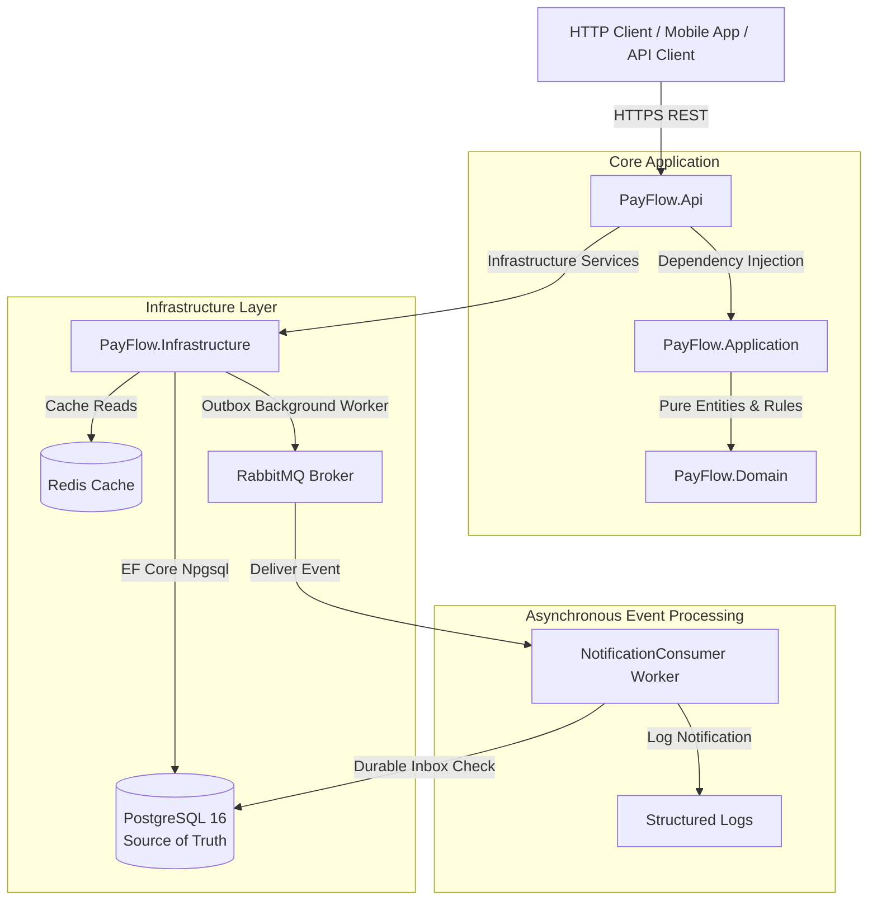
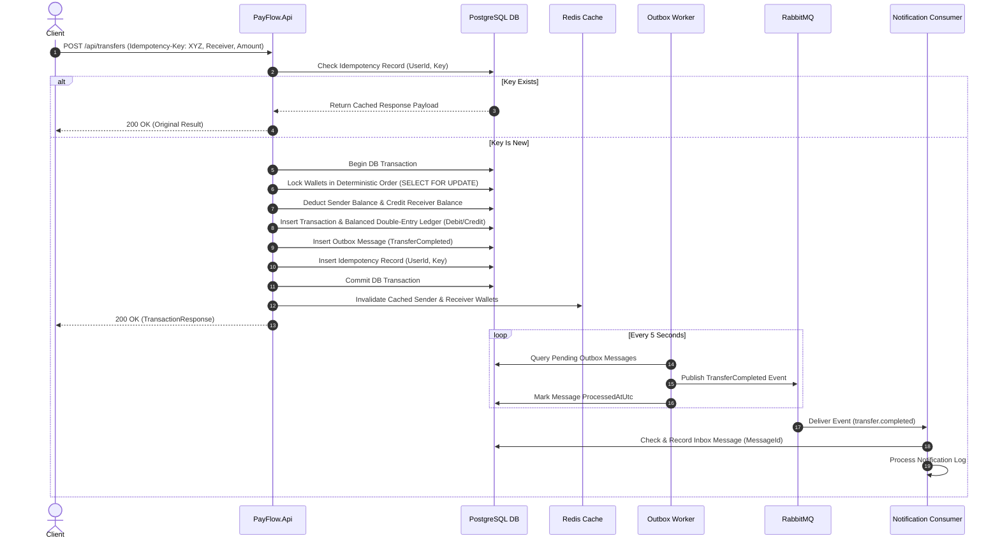

# PayFlow — Digital Wallet & Payment Backend

[](https://dotnet.microsoft.com/)
[](LICENSE)
[](https://github.com/Jaclyn25/PayFlow/actions/workflows/ci.yml)

**PayFlow** is a production-grade, portfolio-quality backend system built from scratch using **.NET 10**, **ASP.NET Core Web API**, **C#**, **Entity Framework Core 10**, **PostgreSQL**, **Redis**, **RabbitMQ**, and **Docker**.

It demonstrates clean modular architecture, financial transfer consistency, double-entry accounting ledgering, database-level idempotency protection, outbox/inbox message processing, JWT refresh token rotation, and OpenTelemetry observability.

---

## 🌟 Key Features & Architectural Guarantees

- **Double-Entry Accounting Ledger**:
  - Every financial transaction (Deposit, Withdrawal, Transfer) creates balanced `Debit` and `Credit` ledger entries.
  - Utilizes a dedicated System Treasury Clearing Account so that `Total Debit == Total Credit` across all system transactions.
- **Safe Money Transfers & Concurrency**:
  - Transfers acquire wallet row locks in deterministic ID order (`min(SenderId, ReceiverId)` then `max(SenderId, ReceiverId)`) using PostgreSQL `SELECT ... FOR UPDATE` row locks to prevent lock-order inversion and reduce deadlock risk.
  - Zero double-spending and non-negative wallet balance policy enforced via PostgreSQL `CHECK ("Balance" >= 0)` database constraints.
- **Database-Level Idempotency**:
  - Mandatory `Idempotency-Key` HTTP header for transfers.
  - Composite unique database constraint `(UserId, Key)` preventing duplicate money movement across concurrent requests or retries.
- **Transactional Outbox & Durable Inbox Processing**:
  - `OutboxMessage` inserted atomically within the financial database transaction.
  - `OutboxBackgroundWorker` dispatches events asynchronously to RabbitMQ.
  - `NotificationConsumer` utilizes a durable `InboxMessage` table in PostgreSQL for idempotent consumer processing across app restarts.
- **Authentication & Security**:
  - JWT Bearer Authentication with short-lived access tokens (15 mins).
  - Cryptographically secure Refresh Tokens stored as SHA-256 hashes in database.
  - Refresh Token Rotation, old token revocation, and reuse rejection.
  - BCrypt password hashing (Work Factor 11).
  - Rate Limiting on authentication endpoints (`FixedWindow` policy).
- **Observability & Health Checks**:
  - Centralized RFC 7807 `ProblemDetails` error handling middleware.
  - Serilog structured logging with request correlation IDs (`X-Correlation-ID`).
  - OpenTelemetry tracing and metrics for ASP.NET Core, HttpClient, and EF Core.
  - Health check endpoints (`/health`, `/readiness`, `/liveness`).

---

## 📐 Architecture & Layer Boundaries

```
src/
├── PayFlow.Domain/          # Pure Domain Entities, System Constants, Enums, Rules & Exceptions
├── PayFlow.Application/     # Use Cases, DTOs, FluentValidators, Service Interfaces
├── PayFlow.Infrastructure/  # EF Core DbContext, PostgreSQL Configurations, Redis, RabbitMQ, Outbox/Inbox Workers
└── PayFlow.Api/             # ASP.NET Core Controllers, Middleware, JWT Setup, OpenTelemetry, Swagger
tests/
├── PayFlow.UnitTests/       # Domain Invariants, Ledger Balance Checks, AuthService & TransferService Unit Tests
└── PayFlow.IntegrationTests/# Integration Tests (Testcontainers PostgreSQL, Concurrency, Idempotency, Deadlock Tests)
docs/
└── adr/                     # Architecture Decision Records (ADR-001 to ADR-004)
```

### System Architecture Diagram



---

## 🔄 Transfer Sequence Diagram



---

## 💡 Engineering Challenges & Interview Talking Points

1. **How is Double-Spending Prevented?**
   - Money transfers acquire wallet row locks in deterministic ascending ID order (`min(A,B)` then `max(A,B)`) using PostgreSQL `SELECT ... FOR UPDATE` row locks to prevent lock-order inversion and reduce deadlock risk. Additionally, PostgreSQL `CHECK ("Balance" >= 0)` constraints enforce balance non-negativity at the database engine level.
2. **How does Database-Level Idempotency Work?**
   - PayFlow enforces idempotency via a composite unique database index `IX_IdempotencyRecords_UserId_Key`. If two duplicate requests hit the server concurrently, PostgreSQL throws a unique constraint violation (`DbUpdateException`) on the second thread, causing it to catch the exception and return the original transaction response cleanly.
3. **Why use the Outbox & Inbox Patterns?**
   - Publishing events directly to RabbitMQ inside HTTP controllers causes dual-write inconsistencies if network drops occur before DB commit. PayFlow persists the `OutboxMessage` in the same PostgreSQL transaction. A background worker dispatches outbox events asynchronously, and the consumer records `InboxMessage` entries for durable inbox-based duplicate processing protection.
4. **How is Double-Entry Accounting Enforced?**
   - Single-sided ledger entries violate accounting invariants. PayFlow introduces a System Treasury Clearing Account (`SystemConstants.SystemWalletId`). Deposits debit System Treasury and credit User Wallet; withdrawals debit User Wallet and credit System Treasury; transfers debit Sender and credit Receiver. Every transaction produces balanced entries where `SUM(Debit) == SUM(Credit)`.
5. **How is Refresh Token Security Handled?**
   - Refresh tokens are stored only as SHA-256 hashes. Upon refresh, the used token is marked revoked. Attempting to reuse an already revoked refresh token results in immediate rejection (`UnauthorizedDomainException`).

---

## 🚀 Running Locally with Docker Compose

```bash
# Clone the repository
git clone https://github.com/Jaclyn25/PayFlow.git
cd PayFlow

# Launch full stack via Docker Compose
docker compose up --build
```

- **Swagger UI**: [http://localhost:5000/swagger](http://localhost:5000/swagger)
- **Health Endpoint**: [http://localhost:5000/health](http://localhost:5000/health)
- **RabbitMQ Management**: [http://localhost:15672](http://localhost:15672) (`guest`/`guest`)

### Development Demo Credentials
- **Alice Smith**: `alice@payflow.local` / `Password123!` (Balance: 1,000 EGP)
- **Bob Jones**: `bob@payflow.local` / `Password123!` (Balance: 500 EGP)

---

## 🧪 Testing

Validated by **31 automated unit and integration tests**:

```bash
dotnet test
```

---

## 📄 Architecture Decision Records (ADRs)

- [ADR-001: Modular Monolith Architecture](docs/adr/ADR-001-modular-monolith.md)
- [ADR-002: PostgreSQL Concurrency Control](docs/adr/ADR-002-postgresql-concurrency-control.md)
- [ADR-003: Database-Level Idempotency Strategy](docs/adr/ADR-003-idempotency.md)
- [ADR-004: Transactional Outbox & Inbox Pattern](docs/adr/ADR-004-outbox-pattern.md)

---

## 📜 License

MIT License - see [LICENSE](LICENSE) for details.
